# Kaustubh Upadhyaya

**Data platform engineer building local-first automation, retrieval, and evaluation systems.**

## GitHub stats

  
  

## Featured work

  
  

  
  

## Automation utilities

Smaller tools that support a job search, kept separate from the work above.

- **[naukri-autoapply](https://github.com/kaustubhupadhyaya/naukri-autoapply)**: sanitized public copy of a Naukri.com Easy Apply automation bot.
- **[job-dashboard](https://github.com/kaustubhupadhyaya/job-dashboard)**: read-only local dashboard for job-application bots, with a demo that needs no real repo.
- **[instahyre-autoapply](https://github.com/kaustubhupadhyaya/instahyre-autoapply)**: applies to Instahyre-matched jobs through a logged-in Edge profile, dry run by default.
- **[linkedin-autoapply-public](https://github.com/kaustubhupadhyaya/linkedin-autoapply-public)**: public sanitized fork of Auto_job_applier_linkedIn with a hardened local runner and supervisor.
- **[gulf-autoapply](https://github.com/kaustubhupadhyaya/gulf-autoapply)**: Gulf and ATS job appliers with dry-run defaults and sample configs.

  Stats and cards generated with <a href="https://github.com/anuraghazra/github-readme-stats">github-readme-stats</a>, served by <a href="https://github.com/stats-organization/github-stats-extended">GitHub Stats Extended</a>.

