# Kaustubh Upadhyaya

**Data platform engineer building local-first automation, retrieval, and evaluation systems.**

I turn messy local data into measured, inspectable pipelines.

## At a glance

  <picture>
    <source media="(prefers-color-scheme: dark)" srcset="./profile/stats-dark.svg">
    
  </picture>
  <picture>
    <source media="(prefers-color-scheme: dark)" srcset="./profile/top-langs-dark.svg">
    
  </picture>

## What I build

- **Data platforms:** lakehouse labs, ETL pipelines, SQL modeling, Airflow orchestration, and cloud-native data infrastructure.
- **Agent tooling:** local automation, retrieval, evaluation, and orchestration systems that are safe to inspect and reproduce.
- **Local-first systems:** privacy-preserving tools that run on a laptop, keep data local, and produce measurable results.

## Featured work

  <a href="https://github.com/kaustubhupadhyaya/nano-banana-facecard">
    <picture>
      <source media="(prefers-color-scheme: dark)" srcset="./profile/pin-nano-banana-facecard-dark.svg">
      
    </picture>
  </a>
  <a href="https://github.com/kaustubhupadhyaya/alpha-round3-lab">
    <picture>
      <source media="(prefers-color-scheme: dark)" srcset="./profile/pin-alpha-round3-lab-dark.svg">
      
    </picture>
  </a>

  <a href="https://github.com/kaustubhupadhyaya/second-brain-toolkit">
    <picture>
      <source media="(prefers-color-scheme: dark)" srcset="./profile/pin-second-brain-toolkit-dark.svg">
      
    </picture>
  </a>
  <a href="https://github.com/kaustubhupadhyaya/digital-profile-creator">
    <picture>
      <source media="(prefers-color-scheme: dark)" srcset="./profile/pin-digital-profile-creator-dark.svg">
      
    </picture>
  </a>

## Automation utilities

Smaller tools that support a job search, kept separate from the work above.

| Tool | What it does |
|---|---|
| [naukri-autoapply](https://github.com/kaustubhupadhyaya/naukri-autoapply) | Sanitized public copy of a Naukri.com Easy Apply automation bot |
| [job-dashboard](https://github.com/kaustubhupadhyaya/job-dashboard) | Read-only local dashboard for job-application bots |
| [instahyre-autoapply](https://github.com/kaustubhupadhyaya/instahyre-autoapply) | Instahyre-matched job applier with dry-run defaults |
| [linkedin-autoapply-public](https://github.com/kaustubhupadhyaya/linkedin-autoapply-public) | Hardened LinkedIn auto-apply runner and supervisor |
| [gulf-autoapply](https://github.com/kaustubhupadhyaya/gulf-autoapply) | Gulf and ATS job appliers with sample configs |

  Stats and cards generated with <a href="https://github.com/anuraghazra/github-readme-stats">github-readme-stats</a>, served by <a href="https://github.com/stats-organization/github-stats-extended">GitHub Stats Extended</a>.

